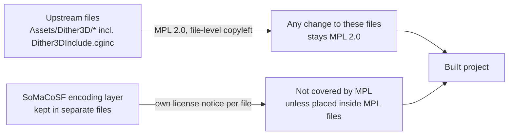

<!--
===============================================================================
file_id: SOM-DOC-PENDING
name: FORK.md
description: Attribution and license boundary for the SoMaCoSF fork of Rune Skovbo Johansen's Surface-Stable Fractal Dithering
project_id: SOMACO-PROTOCOL
category: doc
tags: [dither3d, attribution, mpl-2.0, fork, steganography, gaussian-splat]
created: 2026-10-27
modified: 2026-10-27
version: 1.0.0
agent_id: Devin
execution: Read before using or changing this fork
===============================================================================
-->

# About this fork

**Upstream:** [runevision/Dither3D](https://github.com/runevision/Dither3D).
Surface-Stable Fractal Dithering was invented by **Rune Skovbo Johansen**. The
shader and texture implementation in `Assets/Dither3D` is his work, with
contributions credited in the upstream history (for example Aras Pranckevičius).

**What SoMaCoSF brings:** I came to the idea of encoding identifiers into
rendered surfaces independently. It grew out of RFID work in 2008: devices
talking in symbols over low bandwidth. The SoMaCoSF encoding layer builds on
this dithering to carry GYST UUIDv8 payloads in surface-stable patterns. That
is **steganographic encoding of a payload into a rendered surface**, not a
cryptographic signature. The aim is also to key identifiers into Gaussian splat
parameters.

## License boundary

- Files from upstream remain under the [Mozilla Public License 2.0](LICENSE.md).
  Any change made inside those files is MPL 2.0 too.
- SoMaCoSF encoding code goes in separate files with its own license notice.

## Claim status

| Claim | Status |
|---|---|
| The dithering technique and this implementation are Rune Skovbo Johansen's | PROVEN (upstream README and history) |
| A UUID payload survives render, then re-fit of a Gaussian splat, then decode | OWED (round trip not yet run) |
